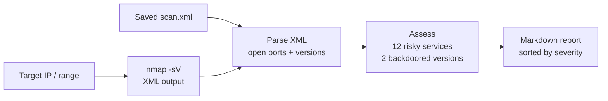

# nmap-recon-reporter


A small Python tool that runs an Nmap service scan (or reads a saved one) and turns the raw
output into a Markdown risk report: findings sorted by severity, each with a plain-language
reason and a fix. It automates the "scan, then write up what matters" step of a vulnerability
assessment. Python 3.8+ standard library only; needs [Nmap](https://nmap.org) for live scans.

> Only scan hosts you own or have written permission to test.

## How it works



1. **Scan** – runs `nmap -sV` (service and version detection) and captures its XML output. This is MITRE ATT&CK technique T1046, Network Service Discovery, done from the defender's side.
2. **Parse** – reads the XML and keeps only open ports, with the service name and version.
3. **Assess** – checks each port against two rule sets (below).
4. **Report** – writes a findings table (worst first) and a per-host port table.

## Rules

| Check | Examples | Severity |
|---|---|---|
| Backdoored versions | vsftpd 2.3.4 (CVE-2011-2523), UnrealIRCd 3.2.8.1 (CVE-2010-2075) | critical |
| Cleartext remote login | telnet | high |
| Exposed remote desktop / file sharing | RDP, VNC, SMB | high |
| Exposed databases | MySQL, PostgreSQL, MSSQL, MongoDB, Redis | high |
| Cleartext file transfer, NetBIOS | FTP, port 139 | medium |
| Unencrypted web | HTTP | low |

## Run it

```bash
python recon_report.py --xml samples/scan.xml
```

```bash
python recon_report.py 192.168.56.101 -o report.md
```

Output on the bundled sample scan (synthetic: one deliberately vulnerable lab VM, one hardened server):

```
2 hosts, 12 open ports, 10 findings (2 critical, 5 high, 2 medium, 1 low)

| Severity | Host | Port | Service | Issue | Fix |
|---|---|---|---|---|---|
| CRITICAL | 192.168.56.101 | 21 | ftp | vsftpd 2.3.4 backdoor gives a root shell (CVE-2011-2523) | Upgrade or remove now |
| CRITICAL | 192.168.56.101 | 6667 | irc | UnrealIRCd 3.2.8.1 backdoor allows remote commands (CVE-2010-2075) | Upgrade or remove now |
| HIGH | 192.168.56.101 | 23 | telnet | Cleartext remote login; passwords can be sniffed | Disable telnet, use SSH |
| HIGH | 192.168.56.101 | 445 | microsoft-ds | SMB exposed; common worm and ransomware entry point | Block 445, allow only needed hosts |
...
```

The hardened server (SSH + HTTPS only) correctly produces no findings.

## Tests

```bash
python -m unittest -v
```

9 tests cover parsing, every severity level, false-positive cases and input validation. GitHub Actions runs them on every push.

## Design decisions worth knowing

- **Rules match the detected service, not the port number.** Telnet moved to port 2323 is still telnet; Nmap's `-sV` identifies it and the rule still fires.
- **Command injection is prevented two ways.** The target is validated against an allow-list pattern, so something like `-oN/etc/passwd` can't be smuggled in as an Nmap option, and Nmap is started with an argument list rather than a shell string, so `; rm -rf /` is never interpreted.
- **XML, not screen-scraping.** Nmap's `-oX` output is a stable machine-readable format; parsing the human-readable text would break between versions.
- **Real scan output is git-ignored** (`report.md`, `*.scan.xml`) because it maps your network.

## Limitations

- Only as accurate as Nmap's version detection; it does not confirm that a vulnerability is exploitable.
- The backdoored-version list is two entries, not a CVE database. A real scanner (Nessus, OpenVAS) covers thousands.
- TCP only by default; no UDP scan and no authenticated checks.
